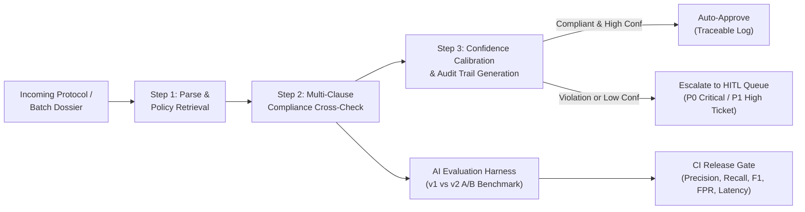

# bio-protocol-eval-worker

**Reproducible AI Evaluation Harness & Human-in-the-Loop Protocol Compliance Digital Worker**

A modular **Agentic AI Compliance Auditor** and **CI/CD Evaluation Release Gate** validated on regulated biological SOPs, biosafety/chemical protocols, and batch Certificate of Analysis (COA) dossiers.

Models the full enterprise **Digital Worker lifecycle** (policy retrieval → multi-clause verification → traceable audit log → confidence-gated Human-in-the-Loop escalation → automated A/B evaluation and regression gating).

---

## Workflow & Release-Gate Architecture



## Key Features
* **Multi-Step Protocol Compliance Digital Worker (`src/eval_worker/verifier_agent.py`):** Retrieves applicable regulatory policies (`POL-BSL2-001`, `POL-CHEM-002`, `POL-CTRL-003`, `POL-EVQC-004`, `POL-COA-005`, `POL-STOR-006`), checks every mandatory evidence clause, records a 4-step audit trace, and generates prioritized `HumanReviewTicket` objects (`P0_CRITICAL`, `P1_HIGH`, `P2_STANDARD`).
* **Reproducible A/B Evaluation Harness (`src/eval_worker/eval_harness.py`):** Benchmarks naive single-check verification (`v1_naive_single_check`) against structured multi-clause verification (`v2_structured_checklist`), logging Precision, Recall, F1, False Positive Rate (FPR), HITL Routing Accuracy, Latency, and Error Taxonomy (`missed_violation`, `false_positive_flag`, `hitl_routing_mismatch`).
* **Automated CI Release Gate (`configs/eval_suite.yaml`):** Enforces minimum Precision/Recall/F1 (`>= 0.85`), max FPR (`<= 0.15`), and latency budgets; exits non-zero in GitHub Actions if any regression is introduced.

---

## Reproducible A/B Evaluation Results

Executed via `make benchmark` on the 4-protocol gold benchmark (`data/benchmark_cases.json`):

| Worker Mode | Precision | Recall | F1 | FPR | HITL Routing Acc | Avg Latency (ms) | Release Gate |
| :--- | ---: | ---: | ---: | ---: | ---: | ---: | :---: |
| `v1_naive_single_check` | 1.000 | 0.600 | 0.750 | 0.000 | 0.750 | 0.875 | **FAIL** |
| `v2_structured_checklist` | **1.000** | **1.000** | **1.000** | **0.000** | **1.000** | **0.508** | **PASS** |

**Key Takeaway:** Under-specified single-check verification (`v1`) misses partial compliance failures (e.g., a COA listing RP-HPLC purity while omitting endotoxin and QA sign-off), dropping recall to `0.600` and failing the automated release gate. Decomposing each policy into explicit clause checklists (`v2`) lifts recall and HITL routing accuracy to `1.000`.

---

## Quickstart (Linux / Docker)

```bash
pip install -r requirements.txt
make test         # Runs unit & release-gate tests
make benchmark    # Runs A/B evaluation and enforces CI release gate
make audit-demo   # Prints full JSON audit report + P0 HITL ticket for a non-compliant protocol
```

### Docker
```bash
make docker-build
docker run --rm bio-protocol-eval-worker:latest
```

---

## Repository Structure
```text
bio-protocol-eval-worker/
├── configs/eval_suite.yaml              # Release-gate & HITL confidence thresholds
├── data/
│   ├── regulatory_policies.json         # 6 structured BSL-2, chemical, control, EV & COA policies
│   ├── sample_protocols/                # 4 compliant and non-compliant biological dossiers
│   └── benchmark_cases.json             # Gold evaluation labels
├── reports/                             # Generated JSON & Markdown A/B evaluation reports
├── src/eval_worker/
│   ├── cli.py                           # CLI for audit, benchmark, and --enforce-gate
│   ├── eval_harness.py                  # A/B evaluator, error taxonomy, release-gate logic
│   ├── schemas.py                       # Pydantic v2 audit, ticket, and gate schemas
│   └── verifier_agent.py                # Multi-step compliance worker with HITL escalation
├── tests/test_eval_worker.py            # Pytest suite
├── Dockerfile
├── Makefile
└── .github/workflows/ci.yml
```
